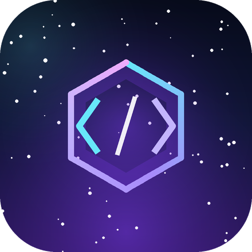

<div align="center">


# IDE Ultimate

**بيئة تطوير متكاملة أنيقة لنظام Android — مبنية بالكامل بـ Kotlin و Jetpack Compose.**

[](https://github.com/AndroidEXL/IDE-Ultimate/actions/workflows/build-apk.yml)
[](https://github.com/AndroidEXL/IDE-Ultimate/releases/latest)


</div>

---

## ✨ نظرة سريعة

| الافتتاحية (Splash) | أيقونة التطبيق |
| :---: | :---: |
|  |  |

مشروع Android كامل بواجهة عربية (RTL) وثيم داكن فضائي، يجمع بين:

- 🌌 **شاشة Splash سينمائية** — سُحب سديمية متدرّجة، حقل نجوم متلألئ مع شهاب عابر، شعار سداسي يدور ببطء، ظهور متتابع للنصوص، وشريط تقدّم متدرّج مع نسبة مئوية تتغيّر حسب المرحلة.
- 🎬 **حركات سلسة** — كلها مبنية على `Animatable` و`rememberInfiniteTransition` و`AnimatedVisibility`، وتُشتغل داخل طور الرسم (draw phase) دون أي مكتبات خارجية.
- 🎨 **أيقونة متكيّفة (Adaptive Icon)** — تعمل على Android 8+ مع نسخة **Monochrome** لأندرويد 13+، وبدائل PNG للأجهزة الأقدم.
- 📱 **دعم كامل للعربية** — خط **Almarai** عربي مضمّن، تخطيط RTL تلقائي، ونصوص عربية/إنجليزية منفصلة.
- ⚡ **شاشة رئيسية Dashboard** — بطاقات زجاجية، معاينة كود ملوّنة، وزر لإعادة تشغيل الافتتاحية.
- 🤖 **بناء APK تلقائي** على GitHub Actions مع رفع الناتج كـ Artifact وإصدار GitHub Release عند إنشاء Tag.

---

## 📲 كيف أحصل على ملف APK؟

**أسرع طريقة:** حمّل أحدث إصدار جاهز من صفحة
[**Releases**](https://github.com/AndroidEXL/IDE-Ultimate/releases/latest) — بدون تسجيل دخول:

```
IDE-Ultimate-1.0.0-release.apk   ← للاستخدام اليومي
IDE-Ultimate-1.0.0-debug.apk     ← للتصحيح والتجارب
```

**أو من خلال Actions:**

1. افتح تبويب **Actions** في المستودع واختر **Build APK**.
2. اضغط **Run workflow** (أو انتظر تشغيله تلقائيًا بعد أي Push).
3. بعد نجاح المهمة، حمّل الملف من قسم **Artifacts** باسم `IDE-Ultimate-APK`
   (يتطلب تسجيل الدخول إلى GitHub):
   - `IDE-Ultimate-1.0.0-debug.apk`
   - `IDE-Ultimate-1.0.0-release.apk` (مُصغّر بـ R8 ومُوقّع بمفتاح debug للعرض)
   - `checksums.txt`

> ⚠️ نسخة الـ release هنا موقّعة بمفتاح **debug** حتى يمكن تثبيتها مباشرة. للنشر على Google Play أنشئ Keystore خاصًا وضع بياناته في GitHub Secrets.

لإنشاء **Release** تلقائي مع ملفات APK مرفقة:

```bash
git tag v1.0.0
git push origin v1.0.0
```

---

## 🎞️ تسلسل الحركة في الافتتاحية

| الزمن | الحدث |
| --- | --- |
| 0.00s | ظهور الخلفية مع تكبير بطيء للسديم (Ken Burns) خلال 7 ثوانٍ |
| 0.16s | ظهور اسم التطبيق بتدرّج لوني وانزلاق ناعم |
| 0.29s | ظهور العبارة التعريفية |
| 0.42s | ظهور شريط التقدّم + حالة التحميل المتغيّرة (تهيئة → Kotlin → معاينة) |
| 0.42–2.72s | امتلاء الشريط من اليمين إلى اليسار (RTL) بنسبة متزايدة |
| 3.06s | تلاشٍ + تكبير طفيف للمحتوى، ثم الانتقال إلى الواجهة الرئيسية |

كل الحركة تُنفَّذ على الـ UI thread دون أي مكتبات أنيميشن خارجية، ويمكن تخطّيها
بالضغط على زر **تخطي** أو زر الرجوع.

---

## 🧱 البنية

```
IDE-Ultimate/
├─ app/src/main/
│  ├─ java/com/androidexl/ideultimate/
│  │  ├─ MainActivity.kt              # توجيه Splash → Home، Edge-to-Edge
│  │  └─ ui/
│  │     ├─ components/               # LogoMark, Starfield, GlassCard, شريط التقدم
│  │     ├─ screens/SplashScreen.kt   # الافتتاحية المتحركة
│  │     ├─ screens/HomeScreen.kt     # الواجهة الرئيسية
│  │     └─ theme/                    # الألوان، الخطوط، Typography
│  ├─ res/
│  │  ├─ drawable/                    # شعارات Vector + AnimatedVector
│  │  ├─ drawable-nodpi/              # خلفية السديم (WebP)
│  │  ├─ font/                        # Almarai + JetBrains Mono
│  │  ├─ mipmap-*                     # أيقونات المتجر والأجهزة القديمة
│  │  └─ values*/                     # الثيمات والنصوص (ar/en)
│  └─ AndroidManifest.xml
├─ design/nebula_source.png           # الخلفية الأصلية بدقة عالية
├─ docs/                              # صور المعاينة والبانر
├─ tools/generate_assets.py           # توليد كل الأصول النقطية آليًا
└─ .github/workflows/build-apk.yml    # CI لبناء APK
```

---

## 🚀 البناء محليًا

```bash
# المتطلبات: JDK 17 + Android SDK (compileSdk 35)
./gradlew assembleDebug        # APK للتجربة
./gradlew assembleRelease      # APK مُصغّر
```

المخرجات:

```
app/build/outputs/apk/debug/app-debug.apk
app/build/outputs/apk/release/app-release.apk
```

أو افتح المجلد مباشرة في **Android Studio** (Ladybug أو أحدث).

---

## ⚙️ التقنيات والإصدارات

| العنصر | الإصدار |
| --- | --- |
| Android Gradle Plugin | 8.9.2 |
| Kotlin + Compose Compiler Plugin | 2.1.20 |
| Gradle | 8.13 |
| Compose BOM | 2025.04.01 |
| compileSdk / targetSdk | 35 |
| minSdk | 24 (Android 7.0) |
| Java | 17 |

المكتبات: `core-ktx`، `core-splashscreen`، `activity-compose`، `lifecycle-runtime-ktx`، `material3`، `material-icons-core`، `ui-tooling-preview`.

---

## 🎨 توليد الأصول

كل الصور النقطية (الخلفية، أيقونات mipmap، صور المعاينة) تُولَّد بسكربت واحد:

```bash
python -m venv .venv && source .venv/bin/activate
pip install -r tools/requirements.txt
python tools/generate_assets.py
```

- الشعار في الأيقونة وواجهة Splash مرسوم بـ **Vector Drawable** (نسخة Android) وبـ **Pillow** (نسخ PNG) بنفس الإحداثيات، لذا يبقى حادًا على كل الكثافات.
- لتغيير الخلفية: استبدل `design/nebula_source.png` ثم أعد تشغيل السكربت.

---

## 🧩 تخصيص سريع

| ما تريد تغييره | المكان |
| --- | --- |
| مدة شاشة Splash | `SplashScreen.kt` → `progress.animateTo(..., tween(2300))` |
| الألوان | `ui/theme/Color.kt` |
| نصوص الافتتاحية | `res/values/strings.xml` و `res/values-en/strings.xml` |
| الشعار | `drawable/ic_splash_logo.xml` + `drawable/ic_launcher_foreground.xml` |
| شاشة النظام (Android 12+) | `res/values-v31/themes.xml` |

---

## 🇬🇧 English

**IDE Ultimate** is a Kotlin/Jetpack Compose Android sample with a cinematic splash
experience: a nebula backdrop, a twinkling star field with an occasional shooting star,
a slowly rotating code-hexagon logo, staged text reveals, and a gradient loader with a
live status readout. It ships with a full adaptive launcher icon (including a monochrome
layer for Android 13+), RTL-first Arabic UI, and a GitHub Actions workflow that builds
debug + release APKs and uploads them as run artifacts.

```bash
./gradlew assembleDebug
```

---

## 📄 License

MIT — see [LICENSE](LICENSE).
